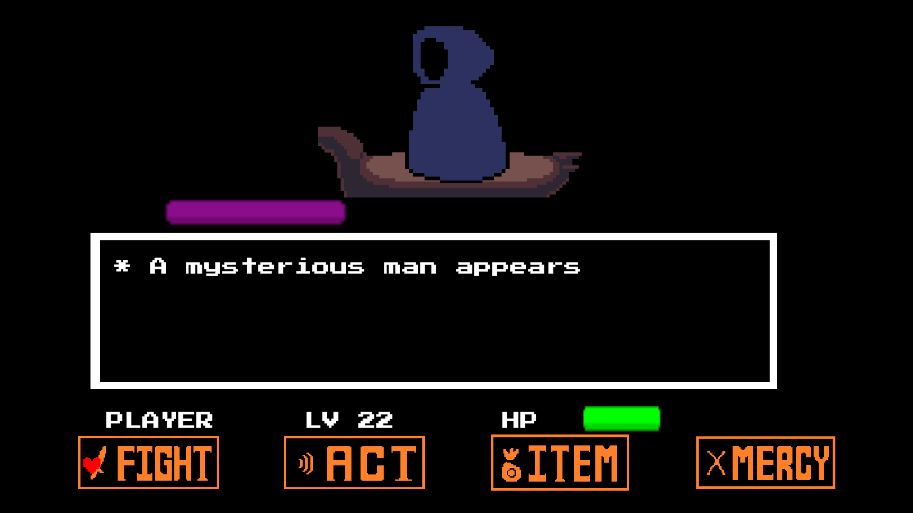
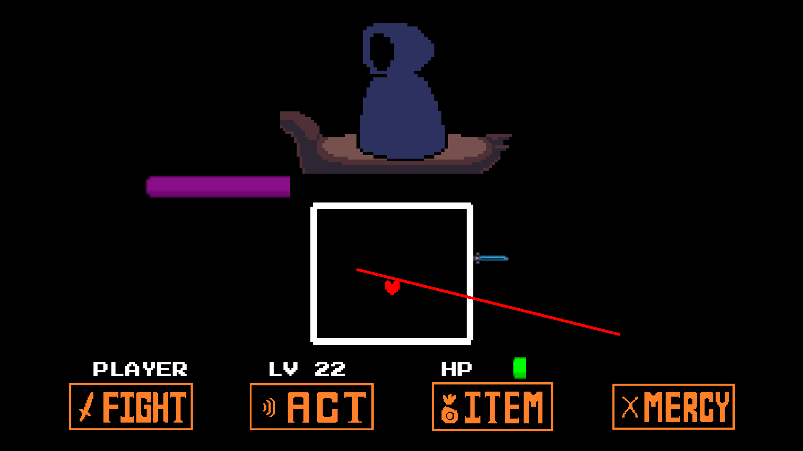
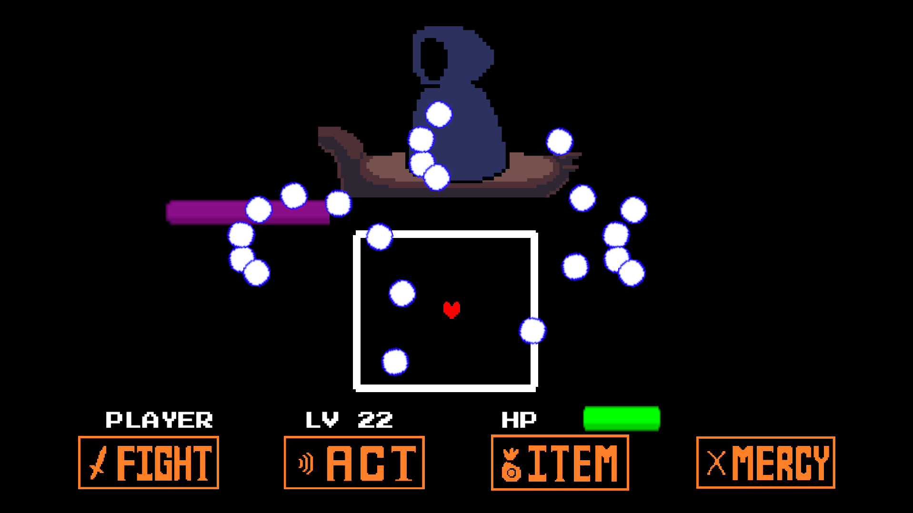

# Undertale-Like Boss Fight

**A 2D, Undertale-inspired boss battle built in Unity with C#.**

This is a personal game-development project focused on recreating the *feel* of a turn-based boss encounter while implementing the gameplay systems in C#. It combines player-controlled dodging, projectile patterns, timed attacks, collision-based damage, and battle UI.

## Download & Play (Windows)

**[Download the latest playable Windows release](https://github.com/nunussdev/undertalelike-boss-fight/releases/latest)**

1. Open the link above and download the Windows ZIP file from the release's **Assets** section (not the auto-generated **Source code** archives).
2. Extract the ZIP file to a folder on your computer.
3. Run `undertalelike-boss-fight.exe` to start the game.

**Platform:** Windows  
**Unity installation:** Not required to play the downloadable build.

To explore or modify the game's source code instead, follow the Unity setup instructions below.

## Features

- **Turn-based battle concept:** A player/enemy battle flow inspired by Undertale.
- **2D heart movement:** Player movement during attack sequences using `Rigidbody2D`.
- **Configurable projectile spawners:** Adjustable firing rate, speed, lifetime, and straight or rotating emission.
- **Multiple attack patterns:** Laser waves, knife attacks, aimed knife rain, and sustained projectile barrages.
- **Telegraphed attacks:** Warning effects appear before certain attacks, giving the player a chance to react.
- **Damage and health UI:** Trigger-based projectile collisions and a UI health bar.
- **Coroutine-driven sequences:** Timed attack events and transitions between attack stages.

## Built With

- **Engine:** Unity 6000.2.5f1
- **Language:** C#
- **Gameplay:** Unity 2D physics, `MonoBehaviour`, coroutines
- **UI:** Unity UI

## Technical Highlights

| Component | Responsibility |
| --- | --- |
| [`HeartMovement.cs`](Assets/Scripts/HeartMovement.cs) | Reads player movement input and controls a `Rigidbody2D`. |
| [`BulletSpawner.cs`](Assets/Scripts/BulletSpawner.cs) | Spawns projectiles with configurable timing and motion. |
| [`Bullet.cs`](Assets/Scripts/Bullet.cs) | Handles projectile lifetime, movement, and 2D collision damage. |
| [`Laser.cs`](Assets/Scripts/Laser.cs) | Controls the timing of a laser's active collider. |
| [`HealthBar.cs`](Assets/Scripts/HealthBar.cs) | Updates the player's health display. |
| [`SideWavePattern.cs`](Assets/Scripts/Patterns/SideWavePattern.cs) | Runs shuffled, telegraphed laser attacks. |
| [`KnifePattern.cs`](Assets/Scripts/Patterns/KnifePattern.cs) | Spawns warning effects followed by moving knives. |
| [`KnifeRainPattern.cs`](Assets/Scripts/Patterns/KnifeRainPattern.cs) | Aims knives toward the player with randomized offsets. |
| [`StabRainPattern.cs`](Assets/Scripts/Patterns/StabRainPattern.cs) | Activates multiple projectile spawners for a fixed duration. |

The attack-pattern classes keep distinct enemy attacks in separate scripts, making it easier to tune individual patterns and add new ones.

## Project Structure

```text
Assets/
├── Scenes/
│   └── SampleScene.unity
└── Scripts/
    ├── Bullet.cs
    ├── BulletSpawner.cs
    ├── HeartMovement.cs
    ├── HealthBar.cs
    ├── Laser.cs
    └── Patterns/
        ├── KnifePattern.cs
        ├── KnifeRainPattern.cs
        ├── SideWavePattern.cs
        └── StabRainPattern.cs
Packages/
ProjectSettings/
```

*Selected files are shown above; the repository contains additional Unity assets and scripts.*

## How to Run

1. Install **Unity Hub** and the Unity Editor version **6000.2.5f1**.
2. Clone this repository or use **Code → Download ZIP** on GitHub and extract it.
3. In Unity Hub, choose **Add project from disk** and select the folder containing `Assets`, `Packages`, and `ProjectSettings`.
4. Open the project in the matching Unity version and allow Unity to import its assets.
5. Open `Assets/Scenes/SampleScene.unity` and press **Play**.

During the dodging portions, movement is read from Unity's **Horizontal** and **Vertical** axes (typically arrow keys or WASD with the standard mappings).


## Gameplay Preview

### Battle Interface







## What I Practiced

This project helped me develop practical experience with:

- Structuring game logic into reusable C# components
- Managing 2D movement and collision-based interactions
- Designing configurable projectile and attack systems
- Timing gameplay events with Unity coroutines
- Connecting combat mechanics to UI feedback

## Disclaimer

This is an **unofficial, non-commercial, Undertale-inspired fan/learning project**. It is not affiliated with or endorsed by Toby Fox or the creators of *UNDERTALE*. *UNDERTALE* and any original game assets remain the property of their respective rights holders.

The gameplay code in this repository is presented as a personal programming project. This notice does not grant permission to redistribute third-party artwork, audio, or other copyrighted content.
